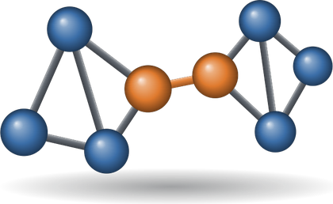
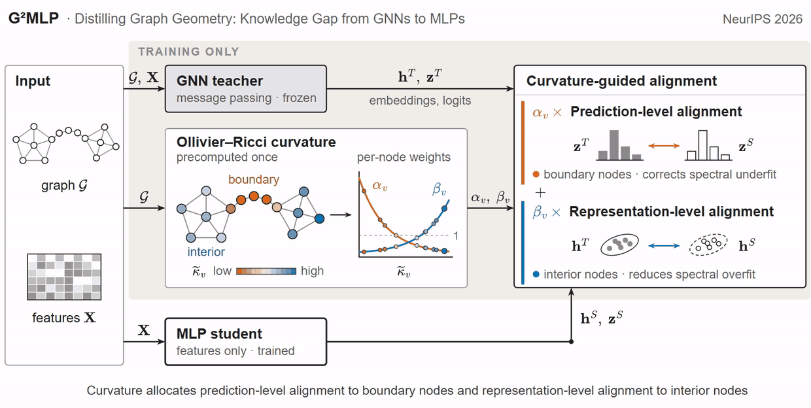

<h1 align="center">
  Distilling Graph Geometry:<br>
  Knowledge Gap from GNNs to MLPs 
</h1>

<p align="center">
  
</p>

G²MLP (Graph Geometry-aware MLP) trains a plain MLP to follow a GNN teacher, then deploys
the MLP on node features alone, with no access to the graph. During training,
Ollivier-Ricci curvature sets, for each node, how much of the supervision goes to
prediction-level alignment and how much to representation-level alignment.

## Getting Started

### Setup Environment

`prepare_env.sh` creates a conda environment named `g2mlp` and installs the requirements.

```bash
bash prepare_env.sh
conda activate g2mlp
```

### Data

The five CPF graphs come from the [CPF repository](https://github.com/BUPT-GAMMA/CPF/tree/master/data/npz).
`ogbn-arxiv` downloads through OGB on first use.

```bash
mkdir -p data
base=https://raw.githubusercontent.com/BUPT-GAMMA/CPF/master/data/npz
curl -fL -o data/cora.npz $base/cora.npz
curl -fL -o data/citeseer.npz $base/citeseer.npz
curl -fL -o data/pubmed.npz $base/pubmed.npz
curl -fL -o data/a-computer.npz $base/amazon_electronics_computers.npz
curl -fL -o data/a-photo.npz $base/amazon_electronics_photo.npz
```

### Usage

Train a teacher, distill it into an MLP, and score the saved student from node features
alone:

```bash
python train_teacher.py --teacher SAGE --dataset cora --seeds 0
python train_student.py --teacher SAGE --dataset cora --seeds 0 --save_ckpt
python evaluate.py --ckpt outputs/checkpoints/nc-tran/cora/SAGE/*_seed_0.pt
```

### Experiments

```bash
# Node classification with the SAGE teacher, transductive and inductive
for dataset in cora citeseer pubmed a-computer a-photo ogbn-arxiv; do
    for setting in tran ind; do
        python train_teacher.py --teacher SAGE --dataset $dataset --setting $setting
        python train_student.py --teacher SAGE --dataset $dataset --setting $setting
    done
done
```

## Citation

```bibtex
@inproceedings{chen2026distilling,
  title     = {Distilling Graph Geometry: Knowledge Gap from {GNNs} to {MLPs}},
  author    = {Chen, Zhewei and Zhu, Hao and Jiang, Jiaojiao and Zehmakan, Ahad N.},
  booktitle = {Advances in Neural Information Processing Systems},
  year      = {2026}
}
```
